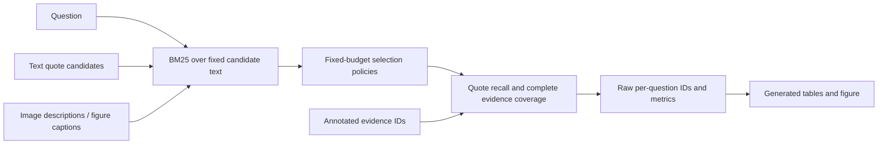

# DocRag: measuring evidence completeness in multimodal document QA

DocRag is a CPU-first research project studying a specific reliability question: **does conventional quote-level retrieval recall overstate how often a context contains the complete evidence set needed to answer a multimodal document question?**

The project now has two research tracks. The lead study is a fixed-candidate evidence-selection analysis on MMDocRAG, with a strict scientific-paper transfer check on SPIQA. A prior QASPER experiment remains as a separately reported negative precursor. The lead study evaluates retrieval context selection, not generated answers or raw visual perception.

## Research question and current findings

On the frozen MMDocRAG evaluation set, global BM25's mean per-question gap between evidence Recall@10 and complete evidence-set coverage was **0.345** (95% paired bootstrap CI [0.327, 0.363], 10,000 resamples; sign-randomization p=0.00009999; n=1,237 cross-modal questions). The gap was larger for cross-modal than single-modality questions by **0.305** (95% CI [0.284, 0.325], permutation p=0.00009999; n=1,237 and 763). These are quote-selection measurements, not proof that generated answers fail.

Within-modality score calibration did not reliably change cross-modal complete-evidence coverage versus global BM25 on MMDocRAG: **+0.008** (95% CI [-0.009, 0.026], paired p=0.410). The strict SPIQA test-B evidence alignment retained **73 of 228** items. On those cross-modal items, the mean gap was **0.432** (95% CI [0.378, 0.485]); equal modality quotas increased complete coverage by **0.219** (95% CI [0.123, 0.315], Holm-adjusted p=0.00050) against global BM25. Because 155 SPIQA questions did not meet the preregistered evidence-alignment rule, this transfer finding is limited and must not be generalized to the full SPIQA test set.

All headline estimates come from committed raw runs and generated artifacts: [MMDocRAG raw results](results/20261110T142142Z_mmdocrag_test_6658f770325d/raw.json), [SPIQA raw results](results/20261110T142218Z_spiqa_test_39e8fba05c7f/raw.json), [generated tables](paper/generated/v2_results.tex), [primary comparisons](paper/generated/v2_primary.tex), and [failure counts](paper/generated/v2_failures.tex). Full protocol and limitations: [docs/RESEARCH_V2.md](docs/RESEARCH_V2.md).

## Study design

- MMDocRAG provides fixed text-quote and image-description candidates, with official dev and held-out evaluation splits. We compare global BM25, equal modality quotas, within-modality score calibration, text-only and image-only selection, and a non-deployable gold-modality allocation reference.
- SPIQA test-B is a separate scientific-paper transfer check. Test items are included only when every provided text evidence context maps to a passage and all visual evidence references map to released captions. Outputs report all exclusions.
- Outcomes include complete evidence-set coverage, quote recall, evidence F1, budget curves, paired bootstrap intervals, randomization/permutation tests, and failure counts.
- Source revisions, data licenses, exact file hashes, protocol hash, and evaluator hash are frozen in [data/frozen/multimodal_manifest.json](data/frozen/multimodal_manifest.json). Dataset files are downloaded locally and are not committed.

The study builds on two recent benchmarks: [SPIQA, NeurIPS 2024](https://proceedings.neurips.cc/paper_files/paper/2024/hash/d74033a247989e8f6f3bf9e0c9629fb5-Abstract-Datasets_and_Benchmarks_Track.html) and [MMDocRAG, NeurIPS 2025](https://proceedings.neurips.cc/paper_files/paper/2025/file/1a93178950e92fd2e7b7448f7d68fd7d-Paper-Datasets_and_Benchmarks_Track.pdf).

## Quick start

Requirements: Python 3.12.5 and `uv`. PyTorch is locked to its CPU index.

```bash
uv sync --locked --group dev
uv run python scripts/download_multimodal_benchmarks.py
uv run python scripts/multimodal_dataset_stats.py
uv run pytest -q -m "not slow and not gpu"
```

To run development experiments on CPU:

```bash
uv run python -m eval.multimodal_selection --dataset mmdocrag --split dev
uv run python -m eval.multimodal_selection --dataset spiqa --split dev
```

To regenerate every paper table and figure from the frozen, committed raw test results:

```bash
uv run python scripts/reproduce_multimodal.py
```

`make reproduce` is an equivalent convenience target where GNU Make is installed. On Windows, use the `uv run` command above or `make` from a compatible shell. A new held-out run requires a clean worktree and matching frozen hashes:

```bash
uv run python -m eval.multimodal_selection --dataset mmdocrag --split test --allow-heldout
uv run python -m eval.multimodal_selection --dataset spiqa --split test --allow-heldout
```

## Architecture



The document-QA application remains available through FastAPI and Streamlit, but its generation quality is not part of this paper's evidence.

## Limitations and status

This is a benchmark-based evidence-selection study using supplied candidate pools. Image candidates are ranked through released descriptions/captions; the work does not evaluate pixels, PDF extraction, or visual models. The SPIQA strict text alignment excludes most test items, so its transfer result has a small denominator. The method comparison does not show a reliable calibration gain on MMDocRAG. No human judgment of generated answers, answer faithfulness, citation accuracy, or abstention calibration was collected.

The work is suitable as a reproducible research portfolio and a preprint draft, not a guaranteed Q1 journal result or a ready-to-submit manuscript. Journal quality and acceptance cannot be promised. See [docs/FINAL_REPORT.md](docs/FINAL_REPORT.md), [paper/STATUS.md](paper/STATUS.md), and [paper/CLAIMS_CHECKLIST.md](paper/CLAIMS_CHECKLIST.md). The owner must personally review every claim and reference before submission. The repository has no source-code license; establish ownership and licensing before redistribution.
