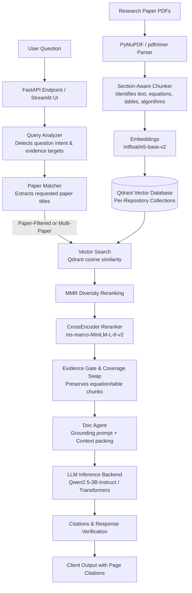

# DocumentRAG

DocumentRAG is a specialized research-paper question-answering system using Retrieval-Augmented Generation (RAG). It is designed to index academic PDFs, preserve critical structural evidence (equations, tables, and algorithms), isolate document collections, and produce grounded answers with traceable section- and page-level citations.

> **Scope.** This repository is one system: a citation-grounded question-answering pipeline for research-paper PDFs (FastAPI + Streamlit + embedded Qdrant). An earlier code-repository variant of the idea ("CodeGraphRAG": AST chunking, knowledge graph, code/data/reasoning agents) lives on in [`experiments/codegraphrag/`](experiments/codegraphrag/README.md) and is **not** part of the paper-QA pipeline. Nothing in `experiments/` is imported by `api/`, `agents/`, `retrieval/`, `storage/` or `ingestion/`.

---

## Problem & Motivation

Standard large language models often generate plausible, fluent text without being strictly grounded in a specific research paper. In academic research and technical inquiry:
- **Hallucinated Equations & Figures:** General models frequently recall remembered or generic formulas rather than the exact mathematical formulations or experimental parameters used in a specific study.
- **Cross-Document Contamination:** When multiple papers are indexed in a shared vector space, multi-paper comparison or single-paper inquiries often retrieve chunks from completely unrelated papers that share generic vocabulary (e.g., "model", "loss", "training").
- **Evidence Drop During Reranking:** Dense formulas, tables, and algorithm listings often have low semantic overlap with natural language questions and get prematurely discarded by naive semantic search or global rerankers.
- **Lack of Traceability:** Answers typically provide vague references rather than verifiable page- and section-attributed source excerpts.

DocumentRAG addresses these challenges by implementing **layout-aware parsing**, **structural chunking**, **paper-level retrieval isolation**, **evidence-aware candidate preservation**, and **strict grounding prompts** that instruct the model to report missing information rather than hallucinating from pretrained weights.

---

## System Architecture

The pipeline processes documents from ingestion to synthesis through the following stages:



### Pipeline Overview

1. **Document Ingestion (`ingestion/`):**
   - [`pdf_parser.py`](ingestion/pdf_parser.py) extracts text blocks, section headings, and font hierarchies using PyMuPDF (with fallback to pdfminer.six).
   - [`doc_chunker.py`](ingestion/doc_chunker.py) performs section-bounded chunking with configurable overlap. It tags chunks with structural metadata (`contains_equation`, `contains_table`, `contains_figure`, `contains_algorithm`) and generates deterministic point hashes to prevent duplication collisions.
2. **Collection Isolation (`storage/registry.py` & `storage/vector_store.py`):**
   - Each workspace or repository is mapped to a dedicated Qdrant collection, preventing inter-collection leakage.
   - Embeddings are generated using `intfloat/e5-base-v2`.
3. **Retrieval & Reranking (`retrieval/`):**
   - [`paper_matcher.py`](retrieval/paper_matcher.py) dynamically inspects query tokens against indexed paper metadata to detect explicit paper references (using acronym and token matching).
   - Multi-paper questions run isolated retrieval passes per identified paper before merging to prevent dominant papers from crowding out secondary papers.
   - Maximal Marginal Relevance (`mmr_rerank.py`) balances relevance with chunk diversity.
   - [`cross_encoder_rerank.py`](retrieval/cross_encoder_rerank.py) applies `cross-encoder/ms-marco-MiniLM-L-6-v2`. If requested evidence (such as an equation) was cut by score truncation, an evidence swap replaces the lowest-scoring generic chunk to preserve required technical context.
4. **Agent Synthesis & Grounding (`agents/`):**
   - [`doc_agent.py`](agents/doc_agent.py) compiles retrieved excerpts into structured context blocks tagged with evidence types, paper titles, sections, and pages.
   - The generation prompt enforces strict grounding: if information is missing from the retrieved context, the agent must return the canonical refusal message rather than guessing.
   - Inline citations are built from chunk metadata linking each statement back to the source paper, section, and page number.

---

## Technology Stack

- **Core Framework & API:** Python 3.10+, [FastAPI](https://fastapi.tiangolo.com/), [Pydantic v2](https://docs.pydantic.dev/), [Uvicorn](https://www.uvicorn.org/)
- **User Interface:** [Streamlit](https://streamlit.io/)
- **Vector Storage:** [Qdrant](https://qdrant.tech/) (embedded local file mode via `qdrant-client`)
- **Embeddings:** `intfloat/e5-base-v2` (via `sentence-transformers`, with CUDA/CPU automatic device resolution)
- **Reranker:** `cross-encoder/ms-marco-MiniLM-L-6-v2`
- **Default LLM Backend:** Hugging Face [Transformers](https://huggingface.co/docs/transformers) running `Qwen/Qwen2.5-3B-Instruct`
- **Alternative LLM Backend (Optional):** Local [Ollama](https://ollama.com/) service integration (`llm/ollama_backend.py`)
- **PDF Extraction:** [PyMuPDF](https://pymupdf.readthedocs.io/) (`fitz`) and `pdfminer.six`

---

## Repository Structure

```
DocRag/
|-- agents/            # doc_agent.py (grounded synthesis + citations), orchestrator.py (LangGraph pipeline)
|-- api/               # FastAPI app: main.py (/query, /health), repository.py (collections), security.py (auth, path allow-list)
|-- ingestion/         # pdf_parser.py, doc_chunker.py, worker.py (background indexing), diff_engine.py
|-- llm/               # Transformers / Ollama backends behind one interface
|-- retrieval/         # paper_matcher, mmr_rerank, cross_encoder_rerank, query_analyzer, repository_router
|-- storage/           # Qdrant manager, registry, caches, progress, snapshots
|-- ui/app.py          # Streamlit front-end
|-- eval/              # evaluation harnesses + datasets + real result artefacts (see "Evaluation")
|   `-- legacy/        # one-off audit/diagnostic scripts from past investigations
|-- experiments/
|   `-- codegraphrag/  # archived code-repo RAG experiments (own agents, KG, benchmark, tests, results)
|-- scripts/           # demo-dataset fetch/build, HPC (Slurm) launchers, benchmark runners
|-- tests/             # fast, model-free regression tests (+ model/GPU tests behind markers)
|-- demo_dataset/      # MANIFEST.json (+ 3 non-arXiv PDFs); the other papers are fetched on demand
|-- docs/              # architecture notes; docs/history/ = old engineering logs (kept for provenance, not maintained)
|-- config.yaml        # pipeline configuration
|-- pyproject.toml     # ruff + pytest configuration
`-- requirements*.txt, constraints.txt, .env.example, LICENSE
```

---

## Setup & Execution

### 1. Environment Setup

Clone the repository and prepare a Python 3.10+ virtual environment:

```bash
git clone https://github.com/likhith1253/DocRag.git
cd DocRag

# Create and activate virtual environment
python -m venv .venv
# On Linux/macOS:
source .venv/bin/activate
# On Windows (PowerShell):
.venv\Scripts\Activate.ps1

# Upgrade packaging tools and install requirements
pip install --upgrade pip setuptools wheel
pip install -r requirements.txt            # add -c constraints.txt to use the versions the tests last ran against

# Optional: fetch the third-party demo PDFs (arXiv; ~90 MB, not stored in git)
python scripts/fetch_demo_dataset.py
```

Copy `.env.example` to `.env` (or export the variables) if you want to change any defaults.

### 2. Configuration

System parameters are defined in [`config.yaml`](config.yaml). The default configuration is configured for local Hugging Face Transformers inference:

```yaml
llm_backend: transformers
hf_model: Qwen/Qwen2.5-3B-Instruct
doc_agent_model: Qwen/Qwen2.5-3B-Instruct
device: auto

embedding_model: intfloat/e5-base-v2
reranker_model: cross-encoder/ms-marco-MiniLM-L-6-v2
qdrant_path: ./qdrant_storage

retrieval:
  vector_top_k: 100
  rerank_top_k: 8
  use_mmr: true
  mmr_lambda: 0.7
```

Key environment variables:
- `LLM_BACKEND`: Override backend selection (`transformers` or `ollama`).
- `ATTN_IMPLEMENTATION`: Override attention implementation (`eager` or `sdpa`).
- `PYTORCH_CUDA_ALLOC_CONF`: Defaults to `expandable_segments:True` to avoid CUDA allocator fragmentation.

### 3. Running Locally

Start the backend API server:

```bash
uvicorn api.main:app --host 127.0.0.1 --port 9001
```

By default the API only answers clients on the loopback interface. To expose it beyond localhost set `DOCRAG_API_KEY` (clients then send `X-API-Key`) and read [Security](#security).

In a separate terminal, launch the Streamlit interface:

```bash
streamlit run ui/app.py --server.port 8501
```

Access the interface in your browser at `http://localhost:8501`.

### 4. Running on HPC (Slurm / Linux Cluster)

For cluster environments with NVIDIA GPUs (e.g., Tesla V100):

1. **Interactive / Direct Launch:**
   ```bash
   cd /path/to/DocRag
   source .venv/bin/activate
   export PYTHONPATH=$(pwd)
   export DOCRAG_API_KEY=...   # required for non-loopback clients
   python -m uvicorn api.main:app --host 0.0.0.0 --port 9001
   ```

2. **Streamlit UI:**
   ```bash
   streamlit run ui/app.py --server.address 0.0.0.0 --server.port 8501
   ```

3. **SSH Port Forwarding (from local client):**
   ```bash
   ssh -L 8501:localhost:8501 <user>@<cluster-gateway>
   ```
   Open `http://localhost:8501` locally.

4. **Slurm Batch Script:**
   Review [`scripts/submit_hpc_job.sh`](scripts/submit_hpc_job.sh) for Slurm allocation details:
   ```bash
   sbatch scripts/submit_hpc_job.sh
   ```

---

## LLM Backend Options

1. **Hugging Face Transformers (Default):**
   - Loads `Qwen/Qwen2.5-3B-Instruct` locally using PyTorch.
   - Automatically utilizes CUDA with `float16` when a GPU is detected; falls back to CPU in `float32`.
   - On Volta architectures (Compute Capability 7.0, e.g., NVIDIA Tesla V100), attention switches to `eager` mode to bypass PyTorch SDPA kernel parameter incompatibilities with long sequences.

2. **Ollama Backend (Optional):**
   - Set `llm_backend: ollama` in `config.yaml` or run with `export LLM_BACKEND=ollama`.
   - Requires an active Ollama instance (defaulting to `http://localhost:11434`).
   - Model name is configured via `doc_agent_model` (e.g., `qwen2.5:3b-instruct`).

*(Note: Third-party hosted commercial APIs such as OpenAI or Anthropic are not part of the active pipeline; inference is handled via self-hosted models to protect data privacy).*

---

## Engineering Challenges & Lessons Learned

During the engineering lifecycle of DocumentRAG, several real-world systems issues were diagnosed and resolved:

1. **Qdrant Chunk Point ID Collisions:**
   - *Problem:* Chunks with identical text content (e.g., repeating chart labels, headers, or copyright footers) across a paper generated matching hash IDs, causing newer chunks to silently overwrite earlier points in Qdrant.
   - *Fix:* Folded an occurrence counter into the hash for duplicate chunk contents and introduced reconciliation verification in [`ingestion/worker.py`](ingestion/worker.py) to guarantee uploaded counts match verified storage points.
2. **Multi-Paper Context Contamination:**
   - *Problem:* Broad semantic search often retrieved passages from unrelated papers in the collection that shared common phrasing (such as "deep reinforcement learning").
   - *Fix:* Built [`retrieval/paper_matcher.py`](retrieval/paper_matcher.py) to extract explicit paper references from queries using token and acronym scoring, allowing the pipeline to isolate retrieval to the requested document.
3. **Evidence Starvation During Reranking:**
   - *Problem:* Relevant equations and table rows scored lower on lexical similarity than descriptive narrative paragraphs, getting truncated before reaching the LLM context.
   - *Fix:* Added structural chunk detection (`contains_equation`, `contains_table`) and an evidence coverage check in [`agents/orchestrator.py`](agents/orchestrator.py) that preserves requested technical chunks in the final context.
4. **PyTorch SDPA & CUDA Memory on Volta (V100):**
   - *Problem:* Long-context prompts (~7,000+ tokens) on Volta architecture GPUs produced low-level kernel driver errors under PyTorch memory-efficient SDPA, while dynamic allocations caused memory fragmentation over continuous runs.
   - *Fix:* Enforced `expandable_segments:True` in `PYTORCH_CUDA_ALLOC_CONF` and routed attention to `eager` on hardware with Compute Capability < 8.0, combined with explicit GPU cache clearing prior to generation.
5. **Cross-Process Registry Staleness:**
   - *Problem:* When the Streamlit UI and API server ran as independent processes, collections created in the UI were missing in the API server process until restarted.
   - *Fix:* Added disk modification checks (`mtime`) on `registry.json` so the registry singleton reloads on cache misses without requiring continuous polling.

---

## Evaluation

### Benchmark: 64 human-verified questions

Latest run of the full pipeline on the demo paper collection, executed on a GPU machine over SSH.

| Metric | Result | How it is defined |
|---|---|---|
| Benchmark size | 64 questions | Human-verified question set |
| Answer accuracy | **54 / 64 (84.4%)** | Answer judged correct against the verified reference |
| Retrieval hit rate | **52 / 64 (81.25%)** | At least one relevant chunk retrieved for the question |
| Citation correctness | **61 / 64 (95.3%)** | Page/section citation verified correct |

> **Next:** run a vector-only and a no-rerank baseline through the same harness to measure how much the reranking and evidence gate add.

## Testing

```bash
pip install -r requirements-dev.txt
python -m pytest                      # fast suite: no GPU, no model downloads (about 30 s)
ruff check .                          # correctness lint (see pyproject.toml)
```

`pyproject.toml` deselects tests carrying these markers by default:

| Marker | Meaning | Run with |
|--------|---------|----------|
| `models` | needs `intfloat/e5-base-v2` / the cross-encoder (downloaded from Hugging Face) | `pytest -m models` |
| `gpu` | needs CUDA | `pytest -m gpu` |
| `slow`, `integration` | long-running or needs an indexed corpus / running service | `pytest -m "slow or integration"` |
| `stale` | pre-existing failures whose expectations drifted from current behaviour; need triage | `pytest -m stale` |

Last results (Windows 11, Python 3.12, CPU torch, empty Hugging Face cache): default suite 215 passed, 1 skipped, 70 deselected. With the two small models cached, the `models` tests pass (45 passed; the two `gpu`-marked tests fail on CPU as expected). The default run also includes the archived experiments' unit tests (`experiments/codegraphrag/tests`) except those marked `stale`/`integration`. The `stale` tests (23, listed by `pytest -m stale --co -q`) fail today and are not claimed to pass. CI (`.github/workflows/ci.yml`) runs ruff and the default suite only.

---

## Security

The API is meant for single-user or trusted-network use. Hardening applied (code in `api/security.py`, regression tests in `tests/test_api_security.py`):

- **Authentication.** Every endpoint except `GET /health` requires `X-API-Key: $DOCRAG_API_KEY`. If no key is configured, only loopback clients are served, so an accidental `--host 0.0.0.0` does not expose the API. Behind a reverse proxy on the same host all requests look like loopback, so set a key there.
- **Filesystem confinement.** `source_path` (collection create/update/reindex) is resolved and must lie inside `DOCRAG_DATA_ROOTS` (default `./demo_dataset`, `./papers`, `./uploads`); `..` and symlink escapes are rejected. Zip archives are extracted with zip-slip and size checks.
- **CORS** is limited to `DOCRAG_CORS_ORIGINS` (default: the local Streamlit UI) and sends no credentials.
- **No error leakage.** 500 responses carry a request id, not exception text. `/health` details (model, device, collections) are shown only to authorized callers.
- `debug_mode` in `config.yaml` now defaults to `false` (it writes retrieved text and prompts under `logs/`).
- Not covered: rate limiting, TLS (terminate in a proxy), per-user authorization (one shared key). The API has no upload endpoint; PDFs are indexed from allow-listed server directories.

---

## Current Limitations

- **Complex Visual Figures:** The parser relies on text and layout extraction via PyMuPDF; diagrams, bitmap images, and visual chart plots are not processed through multimodal vision encoders.
- **Garbled Mathematical Glyphs:** Papers with non-standard embedded font encodings may produce imperfect unicode representations for dense mathematical formulas.
- **Embedded Database Concurrency:** Embedded Qdrant local storage uses file-level locking, designed for single-process API instances. High-throughput horizontal scaling requires migrating to a networked Qdrant server container.

---

## License

MIT, see [LICENSE](LICENSE). The demo PDFs are third-party papers (see `demo_dataset/MANIFEST.json`) and remain under their authors' licenses; the arXiv ones are downloaded on demand rather than redistributed.
