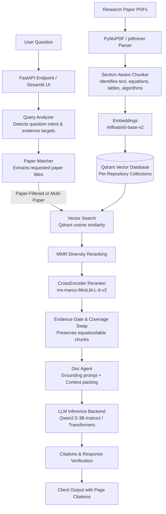

# DocumentRAG

DocumentRAG is a specialized research-paper question-answering system using Retrieval-Augmented Generation (RAG). It is designed to index academic PDFs, preserve critical structural evidence (equations, tables, and algorithms), isolate document collections, and produce grounded answers with traceable section- and page-level citations.

---

## Problem & Motivation

Standard large language models often generate plausible, fluent text without being strictly grounded in a specific research paper. In academic research and technical inquiry:
- **Hallucinated Equations & Figures:** General models frequently recall remembered or generic formulas rather than the exact mathematical formulations or experimental parameters used in a specific study.
- **Cross-Document Contamination:** When multiple papers are indexed in a shared vector space, multi-paper comparison or single-paper inquiries often retrieve chunks from completely unrelated papers that share generic vocabulary (e.g., "model", "loss", "training").
- **Evidence Drop During Reranking:** Dense formulas, tables, and algorithm listings often have low semantic overlap with natural language questions and get prematurely discarded by naive semantic search or global rerankers.
- **Lack of Traceability:** Answers typically provide vague references rather than verifiable page- and section-attributed source excerpts.

DocumentRAG addresses these challenges by implementing **layout-aware parsing**, **structural chunking**, **paper-level retrieval isolation**, **evidence-aware candidate preservation**, and **strict grounding prompts** that instruct the model to report missing information rather than hallucinating from pretrained weights.

---

## System Architecture

The pipeline processes documents from ingestion to synthesis through the following stages:



### Pipeline Overview

1. **Document Ingestion (`ingestion/`):**
   - [`pdf_parser.py`](file:///d:/DocRag/ingestion/pdf_parser.py) extracts text blocks, section headings, and font hierarchies using PyMuPDF (with fallback to pdfminer.six).
   - [`doc_chunker.py`](file:///d:/DocRag/ingestion/doc_chunker.py) performs section-bounded chunking with configurable overlap. It tags chunks with structural metadata (`contains_equation`, `contains_table`, `contains_figure`, `contains_algorithm`) and generates deterministic point hashes to prevent duplication collisions.
2. **Collection Isolation (`storage/registry.py` & `storage/vector_store.py`):**
   - Each workspace or repository is mapped to a dedicated Qdrant collection, preventing inter-collection leakage.
   - Embeddings are generated using `intfloat/e5-base-v2`.
3. **Retrieval & Reranking (`retrieval/`):**
   - [`paper_matcher.py`](file:///d:/DocRag/retrieval/paper_matcher.py) dynamically inspects query tokens against indexed paper metadata to detect explicit paper references (using acronym and token matching).
   - Multi-paper questions run isolated retrieval passes per identified paper before merging to prevent dominant papers from crowding out secondary papers.
   - Maximal Marginal Relevance (`mmr_rerank.py`) balances relevance with chunk diversity.
   - [`cross_encoder_rerank.py`](file:///d:/DocRag/retrieval/cross_encoder_rerank.py) applies `cross-encoder/ms-marco-MiniLM-L-6-v2`. If requested evidence (such as an equation) was cut by score truncation, an evidence swap replaces the lowest-scoring generic chunk to preserve required technical context.
4. **Agent Synthesis & Grounding (`agents/`):**
   - [`doc_agent.py`](file:///d:/DocRag/agents/doc_agent.py) compiles retrieved excerpts into structured context blocks tagged with evidence types, paper titles, sections, and pages.
   - The generation prompt enforces strict grounding: if information is missing from the retrieved context, the agent must return the canonical refusal message rather than guessing.
   - Inline citations are built from chunk metadata linking each statement back to the source paper, section, and page number.

---

## Technology Stack

- **Core Framework & API:** Python 3.10+, [FastAPI](https://fastapi.tiangolo.com/), [Pydantic v2](https://docs.pydantic.dev/), [Uvicorn](https://www.uvicorn.org/)
- **User Interface:** [Streamlit](https://streamlit.io/)
- **Vector Storage:** [Qdrant](https://qdrant.tech/) (embedded local file mode via `qdrant-client`)
- **Embeddings:** `intfloat/e5-base-v2` (via `sentence-transformers`, with CUDA/CPU automatic device resolution)
- **Reranker:** `cross-encoder/ms-marco-MiniLM-L-6-v2`
- **Default LLM Backend:** Hugging Face [Transformers](https://huggingface.co/docs/transformers) running `Qwen/Qwen2.5-3B-Instruct`
- **Alternative LLM Backend (Optional):** Local [Ollama](https://ollama.com/) service integration (`llm/ollama_backend.py`)
- **PDF Extraction:** [PyMuPDF](https://pymupdf.readthedocs.io/) (`fitz`) and `pdfminer.six`

---

## Repository Structure

```
DocRag/
├── agents/                     # Pipeline orchestration and synthesis
│   ├── doc_agent.py            # Grounded QA synthesis and citation construction
│   └── orchestrator.py         # Multi-stage retrieval and routing pipeline
├── api/                        # REST API layer
│   ├── main.py                 # FastAPI application and query endpoints
│   ├── repository.py           # Repository/collection registration and management
│   └── dependencies.py         # Shared API dependencies
├── config.yaml                 # Central system configuration
├── docs/                       # Architectural documentation and audits
│   ├── DEPLOYMENT_ARCHITECTURE.md
│   ├── HPC_DEPLOYMENT_AUDIT.md
│   ├── KNOWN_LIMITATIONS.md
│   ├── MULTI_REPOSITORY_ARCHITECTURE.md
│   ├── ROOT_CAUSE_ANALYSIS.md
│   └── archive/                # Historical engineering logs and phase reports
├── ingestion/                  # Document parsing and chunking
│   ├── doc_chunker.py          # Layout-aware chunking and evidence tagging
│   ├── pdf_parser.py           # PDF text and section extraction (PyMuPDF)
│   └── worker.py               # Background indexing worker with reconciliation
├── llm/                        # Pluggable inference backends
│   ├── backend.py              # Abstract LLM backend interface
│   ├── backend_factory.py      # Backend resolution (Transformers / Ollama)
│   ├── transformers_backend.py # Hugging Face Transformers local inference
│   └── ollama_backend.py       # Optional Ollama HTTP client backend
├── requirements.txt            # Python dependencies
├── retrieval/                  # Search, routing, and reranking
│   ├── cross_encoder_rerank.py # CrossEncoder reranker with score caching
│   ├── mmr_rerank.py           # Maximal Marginal Relevance diversity selection
│   ├── paper_matcher.py        # Query paper identification and scope detection
│   └── query_analyzer.py       # Evidence-intent and structural facet detector
├── scripts/                    # Ingestion, validation, and benchmark runners
│   ├── build_demo_dataset.py
│   ├── run_production_benchmark.py
│   └── submit_hpc_job.sh       # Slurm submission script for HPC execution
├── storage/                    # Persistence, caching, and registries
│   ├── cache.py                # Semantic and answer cache
│   ├── pipeline_logger.py      # Execution tracing and timing logger
│   ├── registry.py             # Repository collection registry
│   └── vector_store.py         # Qdrant client manager and chunk upsert
├── tests/                      # Regression and unit tests
│   ├── test_doc_agent_contract.py
│   ├── test_doc_chunker.py
│   ├── test_indexing_integrity.py
│   ├── test_paper_matcher.py
│   └── test_phase7_regression.py
└── ui/
    └── app.py                  # Streamlit web application
```

---

## Setup & Execution

### 1. Environment Setup

Clone the repository and prepare a Python 3.10+ virtual environment:

```bash
git clone https://github.com/likhith1253/DocRag.git
cd DocRag

# Create and activate virtual environment
python -m venv .venv
# On Linux/macOS:
source .venv/bin/activate
# On Windows (PowerShell):
.venv\Scripts\Activate.ps1

# Upgrade packaging tools and install requirements
pip install --upgrade pip setuptools wheel
pip install -r requirements.txt
```

### 2. Configuration

System parameters are defined in [`config.yaml`](file:///d:/DocRag/config.yaml). The default configuration is configured for local Hugging Face Transformers inference:

```yaml
llm_backend: transformers
hf_model: Qwen/Qwen2.5-3B-Instruct
doc_agent_model: Qwen/Qwen2.5-3B-Instruct
device: auto

embedding_model: intfloat/e5-base-v2
reranker_model: cross-encoder/ms-marco-MiniLM-L-6-v2
qdrant_path: ./qdrant_storage

retrieval:
  vector_top_k: 100
  rerank_top_k: 8
  use_mmr: true
  mmr_lambda: 0.7
```

Key environment variables:
- `LLM_BACKEND`: Override backend selection (`transformers` or `ollama`).
- `ATTN_IMPLEMENTATION`: Override attention implementation (`eager` or `sdpa`).
- `PYTORCH_CUDA_ALLOC_CONF`: Defaults to `expandable_segments:True` to avoid CUDA allocator fragmentation.

### 3. Running Locally

Start the backend API server:

```bash
uvicorn api.main:app --host 0.0.0.0 --port 9001
```

In a separate terminal, launch the Streamlit interface:

```bash
streamlit run ui/app.py --server.port 8501
```

Access the interface in your browser at `http://localhost:8501`.

### 4. Running on HPC (Slurm / Linux Cluster)

For cluster environments with NVIDIA GPUs (e.g., Tesla V100):

1. **Interactive / Direct Launch:**
   ```bash
   cd /path/to/DocRag
   source .venv/bin/activate
   export PYTHONPATH=$(pwd)
   python -m uvicorn api.main:app --host 0.0.0.0 --port 9001
   ```

2. **Streamlit UI:**
   ```bash
   streamlit run ui/app.py --server.address 0.0.0.0 --server.port 8501
   ```

3. **SSH Port Forwarding (from local client):**
   ```bash
   ssh -L 8501:localhost:8501 <user>@<cluster-gateway>
   ```
   Open `http://localhost:8501` locally.

4. **Slurm Batch Script:**
   Review [`scripts/submit_hpc_job.sh`](file:///d:/DocRag/scripts/submit_hpc_job.sh) for Slurm allocation details:
   ```bash
   sbatch scripts/submit_hpc_job.sh
   ```

---

## LLM Backend Options

1. **Hugging Face Transformers (Default):**
   - Loads `Qwen/Qwen2.5-3B-Instruct` locally using PyTorch.
   - Automatically utilizes CUDA with `float16` when a GPU is detected; falls back to CPU in `float32`.
   - On Volta architectures (Compute Capability 7.0, e.g., NVIDIA Tesla V100), attention switches to `eager` mode to bypass PyTorch SDPA kernel parameter incompatibilities with long sequences.

2. **Ollama Backend (Optional):**
   - Set `llm_backend: ollama` in `config.yaml` or run with `export LLM_BACKEND=ollama`.
   - Requires an active Ollama instance (defaulting to `http://localhost:11434`).
   - Model name is configured via `doc_agent_model` (e.g., `qwen2.5:3b-instruct`).

*(Note: Third-party hosted commercial APIs such as OpenAI or Anthropic are not part of the active pipeline; inference is handled via self-hosted models to protect data privacy).*

---

## Engineering Challenges & Lessons Learned

During the engineering lifecycle of DocumentRAG, several real-world systems issues were diagnosed and resolved:

1. **Qdrant Chunk Point ID Collisions:**
   - *Problem:* Chunks with identical text content (e.g., repeating chart labels, headers, or copyright footers) across a paper generated matching hash IDs, causing newer chunks to silently overwrite earlier points in Qdrant.
   - *Fix:* Folded an occurrence counter into the hash for duplicate chunk contents and introduced reconciliation verification in [`ingestion/worker.py`](file:///d:/DocRag/ingestion/worker.py) to guarantee uploaded counts match verified storage points.
2. **Multi-Paper Context Contamination:**
   - *Problem:* Broad semantic search often retrieved passages from unrelated papers in the collection that shared common phrasing (such as "deep reinforcement learning").
   - *Fix:* Built [`retrieval/paper_matcher.py`](file:///d:/DocRag/retrieval/paper_matcher.py) to extract explicit paper references from queries using token and acronym scoring, allowing the pipeline to isolate retrieval to the requested document.
3. **Evidence Starvation During Reranking:**
   - *Problem:* Relevant equations and table rows scored lower on lexical similarity than descriptive narrative paragraphs, getting truncated before reaching the LLM context.
   - *Fix:* Added structural chunk detection (`contains_equation`, `contains_table`) and an evidence coverage check in [`agents/orchestrator.py`](file:///d:/DocRag/agents/orchestrator.py) that preserves requested technical chunks in the final context.
4. **PyTorch SDPA & CUDA Memory on Volta (V100):**
   - *Problem:* Long-context prompts (~7,000+ tokens) on Volta architecture GPUs produced low-level kernel driver errors under PyTorch memory-efficient SDPA, while dynamic allocations caused memory fragmentation over continuous runs.
   - *Fix:* Enforced `expandable_segments:True` in `PYTORCH_CUDA_ALLOC_CONF` and routed attention to `eager` on hardware with Compute Capability < 8.0, combined with explicit GPU cache clearing prior to generation.
5. **Cross-Process Registry Staleness:**
   - *Problem:* When the Streamlit UI and API server ran as independent processes, collections created in the UI were missing in the API server process until restarted.
   - *Fix:* Added disk modification checks (`mtime`) on `registry.json` so the registry singleton reloads on cache misses without requiring continuous polling.

---

## Evaluation & Testing

The repository includes unit and regression suites validating ingestion integrity, paper isolation, and retrieval:

- **Targeted Test Execution:**
  ```bash
  pytest tests/test_doc_agent_contract.py -v
  pytest tests/test_doc_chunker.py -v
  pytest tests/test_indexing_integrity.py -v
  pytest tests/test_paper_matcher.py -v
  pytest tests/test_phase7_regression.py -v
  ```
- **Validation Capabilities:**
  - Verify deterministic and unique chunk hashing.
  - Verify prompt contracts and error handling propagation.
  - Verify paper isolation filters against collection cross-talk.
  - Confirm CPU/GPU fallback paths.

---

## Current Limitations

- **Complex Visual Figures:** The parser relies on text and layout extraction via PyMuPDF; diagrams, bitmap images, and visual chart plots are not processed through multimodal vision encoders.
- **Garbled Mathematical Glyphs:** Papers with non-standard embedded font encodings may produce imperfect unicode representations for dense mathematical formulas.
- **Embedded Database Concurrency:** Embedded Qdrant local storage uses file-level locking, designed for single-process API instances. High-throughput horizontal scaling requires migrating to a networked Qdrant server container.

---

## License

A formal open-source license has not yet been specified for this repository. All rights are reserved by the author until a formal license is added.
