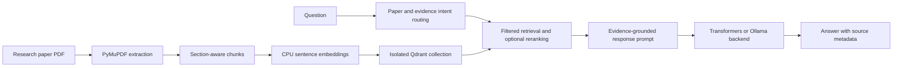

# DocRag: evidence retrieval for research-paper QA

DocRag is a CPU-first prototype for indexing research papers and retrieving evidence for questions. This repository contains a completed, reproducible retrieval study on QASPER. Its previous regex-based acceptance benchmark is retained only as historical regression material and is not scientific evidence.

## Research question

The primary study asks whether a simple, generic structure-aware retrieval step improves recovery of annotator-highlighted table/figure evidence on QASPER, compared with BM25, dense retrieval, reciprocal-rank fusion, cross-encoder reranking, and MMR. The full protocol and falsification criteria are in [docs/RESEARCH.md](docs/RESEARCH.md). QASPER was introduced by Dasigi et al. at NAACL 2021; the dataset release is identified by a pinned Hugging Face revision and file hashes in [data/frozen/qasper_manifest.json](data/frozen/qasper_manifest.json).

The test split is frozen by dataset and evaluator hashes in the manifest; its run additionally required explicit opt-in and a clean worktree. It has now been scored once under the registered six-system protocol. The raw output and derived tables are committed and linked below.

## Status

- The CPU-locked package, typed settings, generation cache, API/UI, and core regression tests are present. The deterministic fast suite passes locally; see [docs/PLAN.md](docs/PLAN.md).
- The QASPER retrieval study is complete. On the predeclared table/figure subset, structure-aware ordering over MMR had a Recall@10 difference of +0.0075 (95% paired bootstrap CI [-0.0081, 0.0253], p=0.4153, n=220), so the primary improvement hypothesis was not supported. Overall it improved over MMR by +0.0181 (95% CI [0.0113, 0.0254], n=1,272), but remained below cross-encoder reranking without MMR. See the [raw test run](results/20261110T125049Z_test_b266b19c27/raw.json), generated [summary table](paper/generated/main_results.tex), [pairwise tests](paper/generated/pairwise_comparisons.tex), and [failure taxonomy](results/20261110T125049Z_test_b266b19c27/failure_analysis.json).
- The V100 generation path, external API backends, and end-to-end answer quality are **NOT VERIFIED**.
- PDFs preserved from the previous checkout have unresolved redistribution licenses and are excluded from all study runs.
- The repository has no source-code license. Do not redistribute the application as open source until ownership and licensing are reviewed. The QASPER dataset itself is identified as CC BY 4.0 by its pinned dataset card; the data are downloaded locally rather than committed.
- See the [model and data card](docs/DATA_MODEL_CARD.md) and [contribution guide](CONTRIBUTING.md) for provenance, license checks, and reproduction expectations.

## Setup

Requirements: Windows, Linux, or macOS; Python 3.12.5; `uv`. PyTorch is resolved from the CPU-only PyTorch index.

```bash
uv sync --locked --group dev
uv run pytest -q -m "not slow and not gpu"
uv run ruff check settings.py llm/cache.py retrieval/query_analyzer.py retrieval/paper_matcher.py eval/qasper_study.py eval/failure_analysis.py eval/paper_table.py scripts/dataset_stats.py scripts/download_qasper.py scripts/reproduce.py scripts/smoke_generation.py scripts/verify_cuda_generation.py scripts/verify_project.py tests/test_qasper_study.py
uv run mypy
uv run python scripts/verify_project.py
```

The verification command archives exact lint, type-check, fast-test, and package-build output with a configuration hash under `results/verification/`.

On Windows PowerShell, use `uv.exe` and the same arguments. For the research dataset and retrieval model, network access to Hugging Face is required once.

## Reproduce the retrieval study

Download the pinned QASPER files and verify their hashes:

```bash
uv run python scripts/download_qasper.py
uv run python scripts/dataset_stats.py
```

Full validation development run:

```bash
make reproduce-dev
```

This runs all six retrieval conditions, then generates the failure taxonomy and manuscript table from the saved raw run. The first 25-question validation prefix remains an optional schema/performance smoke check only.

```bash
uv run python -m eval.qasper_study --split validation --systems bm25,dense,hybrid,rerank,mmr,structure --top-k 10 --candidate-k 40 --limit 25
```

After validation is complete and the protocol implementation is committed, run the frozen test once:

```bash
make reproduce
```

Raw per-question rankings, metrics, configuration hash, data hash, hardware/runtime metadata, and commit are saved beneath `results/`. `make reproduce` requires network access to download the hash-verified dataset on a clean machine and CPU time for all models. It does not generate an answer-quality score: this is a retrieval-only study.

## Run the application

The application supports paper ingestion and retrieval through a FastAPI API and Streamlit UI. Use CPU-compatible settings by default. Model files download on first use and may require substantial RAM.

```bash
uv run uvicorn api.main:app --host 127.0.0.1 --port 9001
uv run streamlit run ui/app.py
```

Container build and run (Docker daemon required):

```bash
docker build -t docrag-research:local .
docker run --rm -p 9001:9001 -v docrag-data:/data docrag-research:local
```

The Dockerfile keeps Qdrant and registry state in `/data`. This container build could not be verified in the current session because the Docker Desktop Linux engine was unavailable.

## Architecture



## Limitations

The primary experiment is a retrieval study on English NLP papers. It does not establish generality across sciences, correct parsing of all equations or diagrams, factual accuracy of generated answers, calibrated abstention, or human agreement. The current risk scanner checks selected numerical/equation mismatches; it is not a semantic claim verifier. Cross-paper comparison and model-generation behavior are product features, not validated research findings. See [docs/DECISIONS.md](docs/DECISIONS.md) and [docs/FINAL_REPORT.md](docs/FINAL_REPORT.md) for current progress and unverified items.

## References

- Dasigi, Pradeep, Kyle Lo, Iz Beltagy, Arman Cohan, Noah A. Smith, and Matt Gardner. 2021. [A Dataset of Information-Seeking Questions and Answers Anchored in Research Papers](https://aclanthology.org/2021.naacl-main.365/). NAACL-HLT, 4599–4610. DOI: 10.18653/v1/2021.naacl-main.365.
